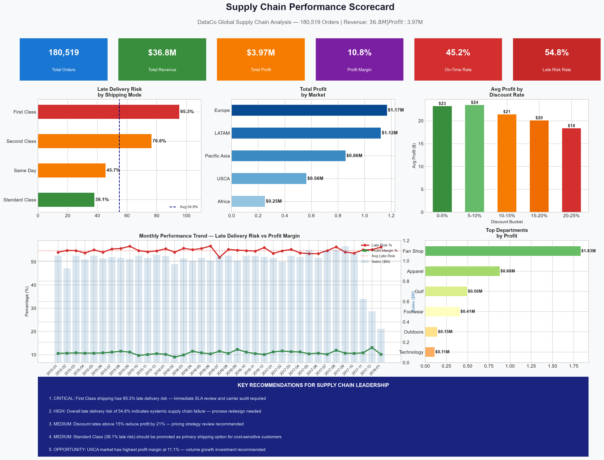
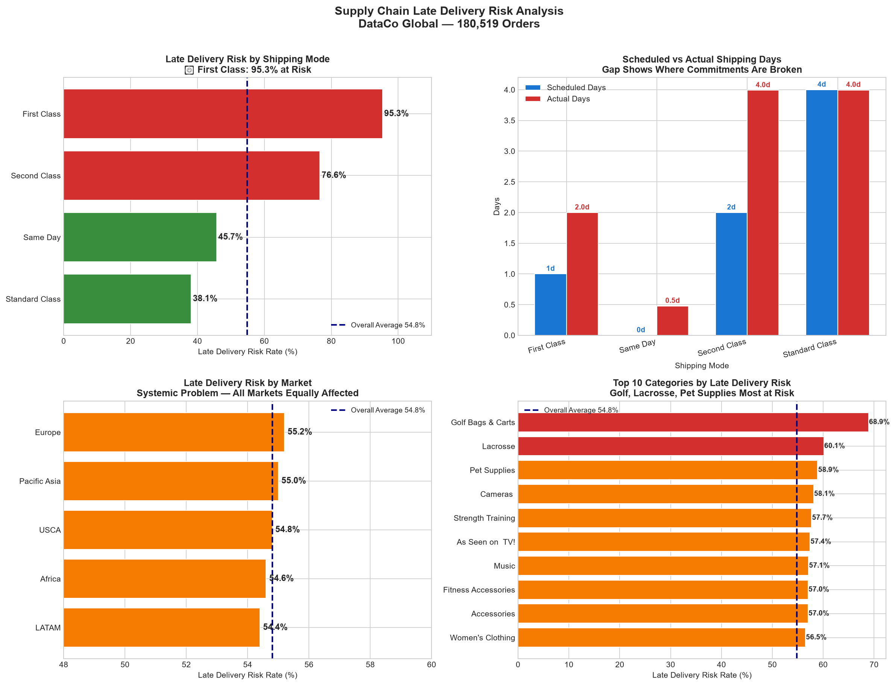
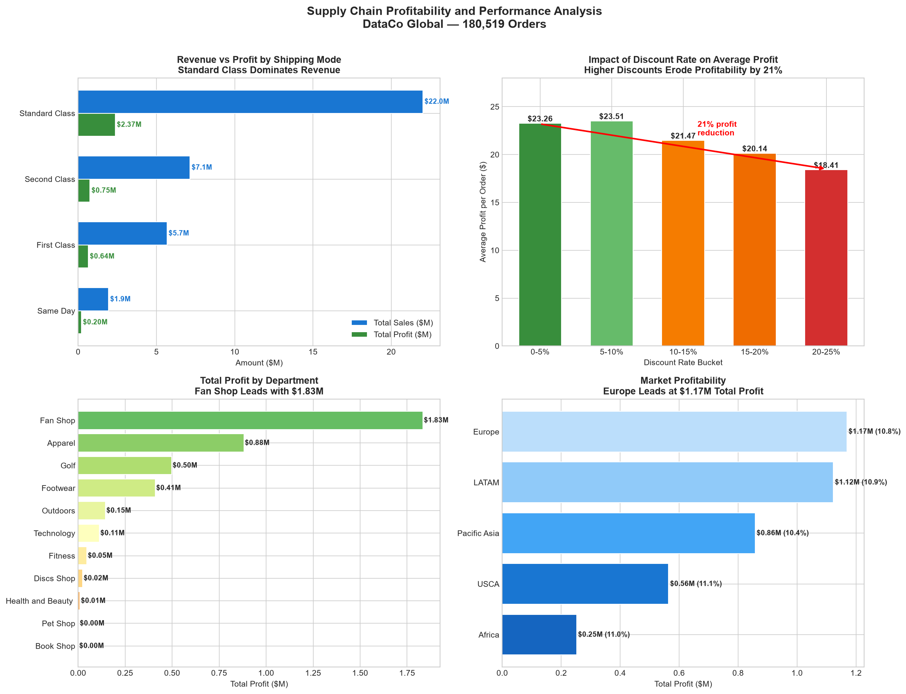

# Supply Chain Performance Analysis
## End-to-End Analytics on 180,519 Real Supply Chain Orders

### Project Overview
Comprehensive supply chain performance analysis on a real global
dataset covering 5 markets, 4 shipping modes, and 11 departments.
Identifies critical operational failures, profitability drivers,
and provides prioritised recommendations for supply chain leadership.

**Tools:** Python, Pandas, NumPy, Matplotlib, Seaborn,
Jupyter Notebook
**Dataset:** DataCo Smart Supply Chain Dataset (Kaggle)
**Scale:** 180,519 orders | $36.8M Revenue | $3.97M Profit

---

### Executive Dashboard

---

### Critical Finding 1 — Late Delivery Crisis
**54.8% of all orders are at risk of late delivery**

| Shipping Mode | Late Risk Rate | Status |
|--------------|---------------|--------|
| First Class | 95.3% | CRITICAL |
| Second Class | 76.6% | HIGH |
| Same Day | 45.7% | MEDIUM |
| Standard Class | 38.1% | BEST |

Key Insight: Customers paying premium prices for First Class
shipping experience the WORST delivery performance.
Standard Class is the only mode meeting its commitments.

---

### Critical Finding 2 — Systemic Not Geographic
Late delivery risk is almost identical across ALL markets
(54.4% to 55.2%), confirming this is a systemic operational
failure not a regional issue. The root cause lies in the
core shipping commitment and fulfillment process.

---

### Finding 3 — Shipping Commitment Failures

| Shipping Mode | Promised | Actual | Variance |
|--------------|---------|--------|---------|
| First Class | 1 day | 2.0 days | +1.0 day |
| Second Class | 2 days | 4.0 days | +2.0 days |
| Same Day | 0 days | 0.5 days | +0.5 days |
| Standard Class | 4 days | 4.0 days | 0 days |

Standard Class is the ONLY mode consistently meeting its
delivery commitment.

---

### Finding 4 — Discount Strategy Eroding Profit

| Discount Rate | Avg Profit per Order |
|--------------|---------------------|
| 0 to 5% | $23.26 |
| 5 to 10% | $23.51 |
| 10 to 15% | $21.47 |
| 15 to 20% | $20.14 |
| 20 to 25% | $18.41 |

Discounts above 15% reduce profit by 21% with no
evidence of sufficient volume compensation.

---

### Recommendations

1. **CRITICAL** — Audit and redesign First Class shipping SLAs.
   95.3% late risk on premium shipping is destroying
   customer trust and brand reputation.

2. **HIGH** — Investigate root cause of systemic 54.8%
   late delivery risk. Identical rate across all markets
   confirms a core process failure.

3. **HIGH** — Reposition Standard Class as flagship shipping.
   Most reliable at 38.1% late risk and drives 59.9%
   of all revenue.

4. **MEDIUM** — Cap discount rates at 15% maximum.
   Higher discounts reduce profit by 21% without
   clear volume benefit.

5. **OPPORTUNITY** — Invest in USCA market growth.
   Highest profit margin at 11.1% with significant
   scale potential.

---

### How to Run

1. Clone this repository
2. Install requirements: pip install pandas numpy
   matplotlib seaborn jupyter
3. Open: jupyter notebook
4. Run: Supply_Chain_Performance_Analysis.ipynb

---

### About
Portfolio project by Sankruth Sriram — Supply Chain and
Operations Analytics Professional based in Berlin.

LinkedIn: linkedin.com/in/sankruth-sriram
Email: sankruth8@gmail.com
